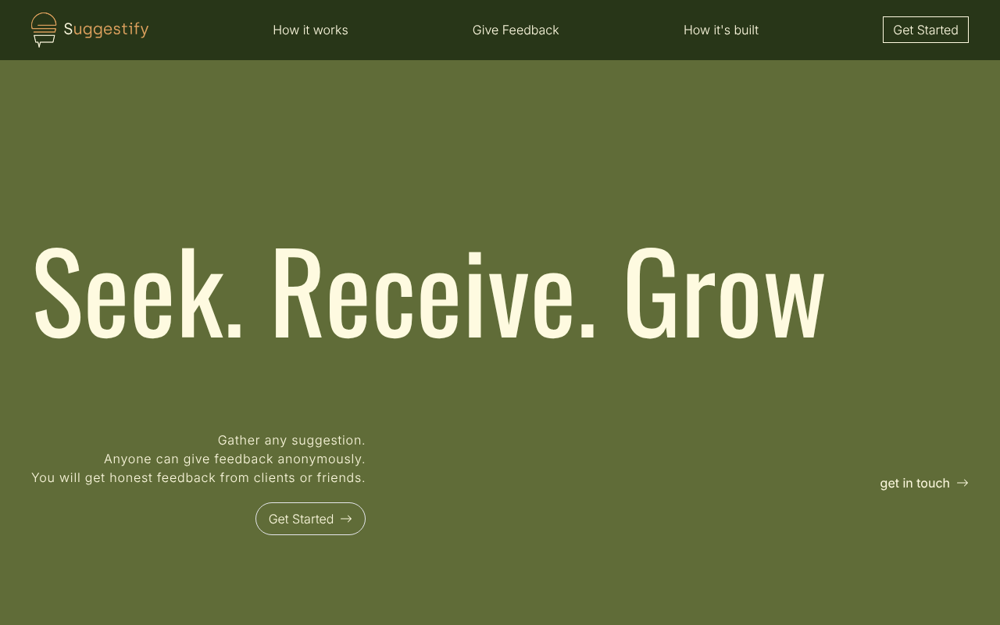
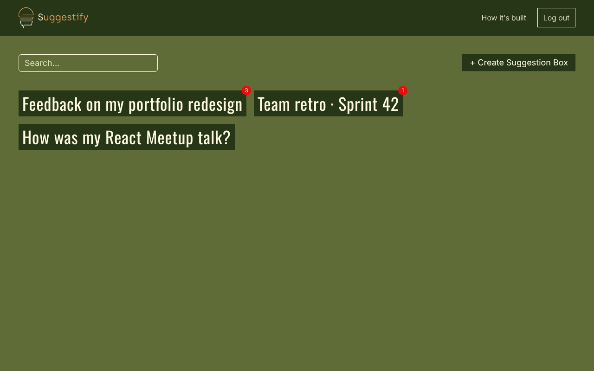
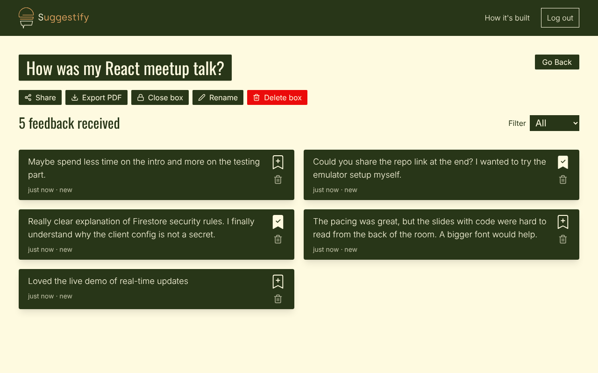
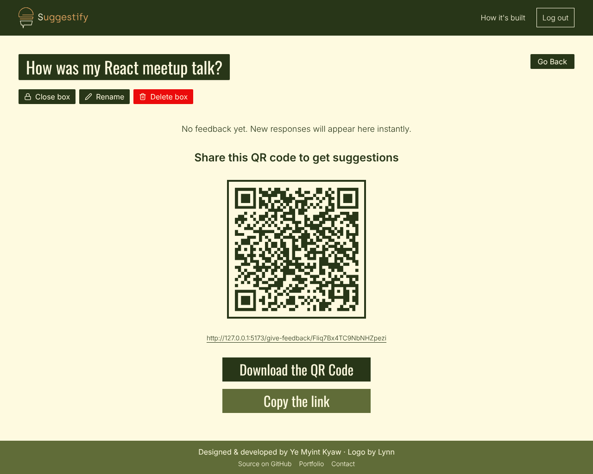
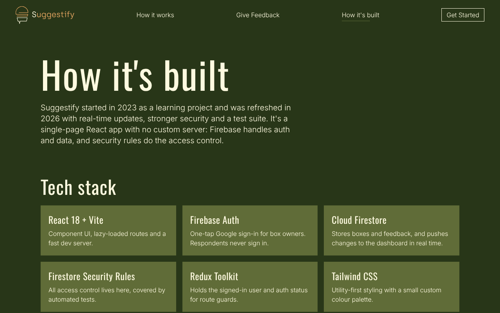
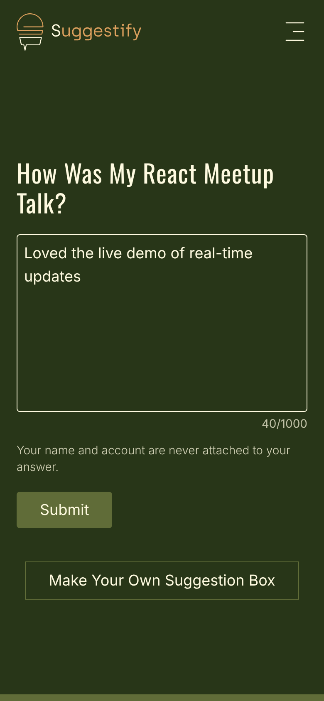
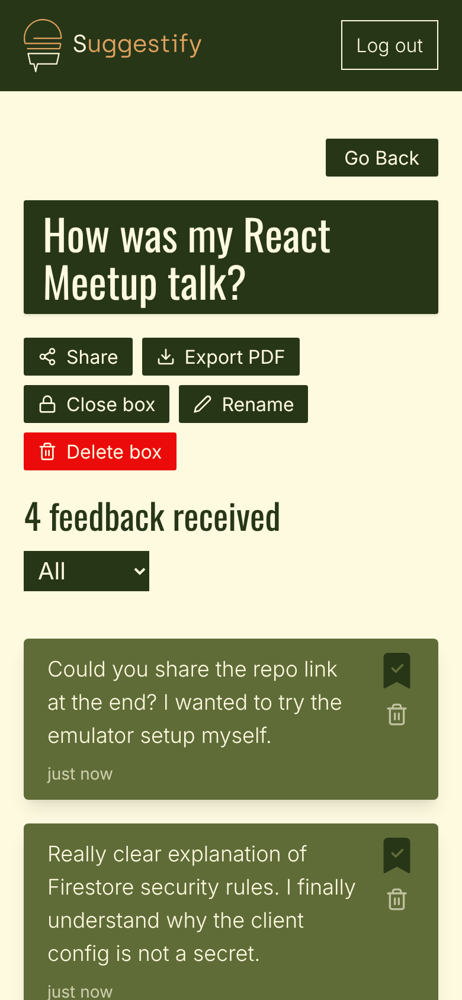
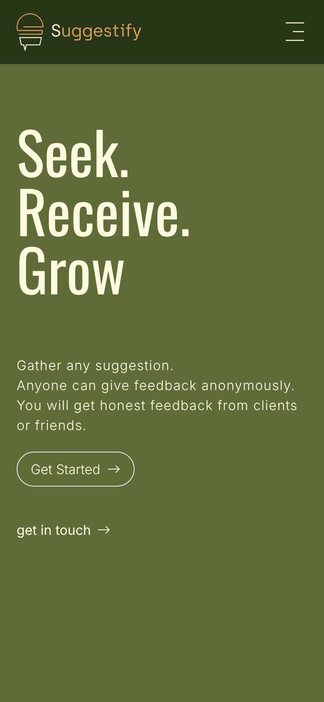
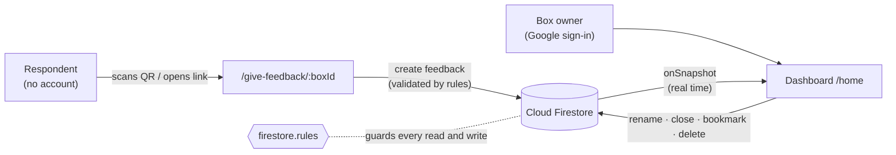

<div align="center">


# Suggestify

**Collect honest, anonymous feedback with a suggestion box you can share as a link or QR code.**

[Live demo](https://suggestify1.firebaseapp.com/) · [How it's built](https://suggestify1.firebaseapp.com/how-it-is-developed) · [The story on Medium](https://medium.com/@yemyintkyaw/suggestify-replacement-of-the-suggestion-box-0ddb61fc0d83)

[](https://github.com/ye-myint-kyaw/Suggestify/actions/workflows/ci.yml)




</div>

## Why

A physical suggestion box gets ignored, and people hold back when their name is attached.
Suggestify gives anyone, from a speaker after a talk to a team after a sprint, a box that
people can open by scanning a QR code. They answer anonymously, without an account, and
the owner sees each response the moment it arrives.

## Features

**For box owners**
- One-tap **Google sign-in**
- Create, **rename**, **close / reopen** and delete suggestion boxes
- Share with a **link, a downloadable QR code** or the phone's **native share sheet**
- **Real-time** feedback list and unread badges, with no refresh button needed
- **Bookmark**, filter (All / Saved / Unread) and delete individual feedback
- **Export to PDF** (react-pdf, generated in the browser and loaded only on demand)

**For respondents**
- No account, no tracking: open the link, type, send
- Character counter with a 1,000-character limit, and clear states for closed or deleted boxes

## Screenshots

| Owner dashboard | Feedback in a box |
| --- | --- |
|  |  |
| **Share as QR code** | **How it's built page** |
|  |  |

<p align="center">
  
  &nbsp;&nbsp;
  
  &nbsp;&nbsp;
  
</p>

## Tech stack

| Area | Tools |
| --- | --- |
| UI | React 18, React Router 6 (lazy-loaded routes), Tailwind CSS 3, Formik |
| State | Redux Toolkit (auth state for route guards); Firestore listeners for data |
| Backend | Firebase Authentication (Google), Cloud Firestore. No custom server |
| Extras | react-pdf (PDF export), qrcode, react-hot-toast, ScrollReveal, Typed.js |
| Quality | ESLint, Vitest, `@firebase/rules-unit-testing` + Firestore emulator, GitHub Actions |
| Hosting | Firebase Hosting (Vercel and Netlify configs included) |

## Architecture



**Data model**

```
users/{uid}                          owner profile
users/{uid}/feedbacks/{boxId}        owner's link to a box   { name, isOpen }
feedbackBox/{boxId}                  public box info         { name, timestamp, isOpen }
feedbackBox/{boxId}/feedback/{id}    anonymous feedback      { feedback, isMarked, isRead, dateTime }
```

Creating and deleting a box are **atomic batched writes**, so a box can never be half-created,
and deleting it also removes all of its feedback.

## Security

There's no backend, so [`firestore.rules`](firestore.rules) does all the access control. The
rules are covered by [18 automated tests](tests/firestore.rules.test.js) that run against the
Firestore emulator in CI:

- Anyone can send feedback, but **only to a box that exists and is open**, and only as plain text of 1–1000 characters.
- **Only the owner** can read, bookmark or delete a box's feedback. Nobody, the owner included, can edit what someone wrote.
- Box IDs are public (they're in the share link), so **ownership can only be claimed for a box that doesn't exist yet**. This blocks taking over someone else's box from its link.
- Boxes can be opened by ID, but **nobody can list every box**.

> The Firebase web config (see [`.env.example`](.env.example)) is public by design. It identifies the project; it doesn't grant access.
> It's still kept out of git, so each developer and host provides their own `.env`.

## Getting started

**Prerequisites:** Node.js 22.12+, Yarn 1.x, and Java 21 (only needed for the Firebase emulators).

```bash
git clone https://github.com/ye-myint-kyaw/Suggestify.git
cd Suggestify
yarn install
```

### Option A: run fully offline with the Firebase emulators (recommended)

```bash
yarn emulators        # terminal 1: Auth + Firestore emulators, Emulator UI at http://127.0.0.1:4000
yarn dev:emulators    # terminal 2: app at http://localhost:5173 wired to the emulators
```

No `.env` needed. This uses the `demo-suggestify` project ID from `.env.emulator`, so nothing touches
real Firebase resources. The Auth emulator shows a fake Google account picker when you sign in.

### Option B: use your own Firebase project

1. Create a Firebase project, enable **Google** sign-in under Authentication, and create a Firestore database.
2. Create your `.env` (git-ignored) and fill it in from *Project settings → General → Your apps*:

   ```bash
   cp .env.example .env
   ```

3. Deploy the security rules (`npx firebase deploy --only firestore:rules --project your-project`) and run `yarn dev`.

## Scripts

| Command | What it does |
| --- | --- |
| `yarn dev` | Start the dev server against the Firebase project in `.env` |
| `yarn dev:emulators` | Start the dev server against the local emulators |
| `yarn emulators` | Start the Auth + Firestore emulators |
| `yarn build` / `yarn preview` | Production build / preview it locally |
| `yarn lint` | ESLint with zero warnings allowed |
| `yarn test` | Security rules tests and unit tests (starts the Firestore emulator automatically) |
| `yarn test:unit` | Unit tests only, without the emulator |

## Deployment

The live demo runs on **Firebase Hosting**. Make sure `.env` holds the project's config (see
[Option B](#option-b-use-your-own-firebase-project)), then:

```bash
yarn build
npx firebase deploy --only hosting,firestore:rules
```

Deploy the rules and the app **together**: the app relies on the current rules (for example,
atomic box creation). `vercel.json` and `netlify.toml` provide SPA rewrites if you prefer those hosts. There, set the
same `VITE_FIREBASE_*` variables in the project's environment settings, and add the domain under
*Authentication → Settings → Authorized domains* so Google sign-in works.

## Project structure

```
src/
├── components/          # Navbar, Footer, Modal, QR share panel, route guards, landing sections…
├── hooks/
│   └── useFeedbackBoxes.js   # live list of a user's boxes + unread count per box
├── pages/               # one folder per route (lazy-loaded)
│   ├── LandingPage/  GetStarted/  Home/  SuggestionBoxCreation/
│   ├── Feedbacks/       # owner's box view: live list, filters, box controls, PDF export
│   ├── FeedbackGiven/   # public anonymous form
│   └── HowItsDeveloped/  NotFound/  Pdf/
├── store/               # Redux Toolkit: auth state (loading / authenticated / guest)
├── util/
│   ├── firebase.js      # Firebase setup + every Firestore read, write and subscription
│   └── helpers.js       # timeAgo, slugify, downloadBlob (+ unit tests)
├── routes.jsx           # routes, guards and code splitting
└── App.jsx              # auth listener + layout
tests/firestore.rules.test.js   # security rules tests (emulator)
firestore.rules                 # access control
```

## 2026 refresh

I built Suggestify in 2023 while learning React and Firebase. In 2026 I came back to it with
more experience:

- **Security:** closed a hole where anyone with a share link could claim a box and read its
  feedback; feedback writes are now validated, and the rules have tests.
- **Reliability:** atomic box creation and deletion (no more orphaned data), proper auth
  loading state with route guards, and listener cleanup.
- **Features:** real-time updates, close/reopen, rename, delete single feedback, native
  sharing, character limits, and empty, not-found and 404 states.
- **Performance:** removed about 11 MB of stale build files that were committed in `public/`;
  routes are code-split and the 1.2 MB PDF library loads only when exporting.
- **Tooling:** Vite 8, Firebase 12, Redux Toolkit 2, emulator-based local dev, and CI.
- **Accessibility:** semantic landmarks, labelled icon buttons, keyboard-friendly dialogs,
  and reduced-motion support.
- Replaced commercially licensed Helvetica files with open-source Inter and Oswald.

## Roadmap

- Firebase App Check to protect the public feedback form from spam
- Migrate to TypeScript
- Component tests for the main flows

## Author

**Ye Myint Kyaw**, Front-End Engineer

[Portfolio](https://yemyintkyaw.dev) · [GitHub](https://github.com/ye-myint-kyaw) · [Email](mailto:yemyintkyaw.dev@gmail.com)

Logo by [Lynn](https://instagram.com/leonegan8).
